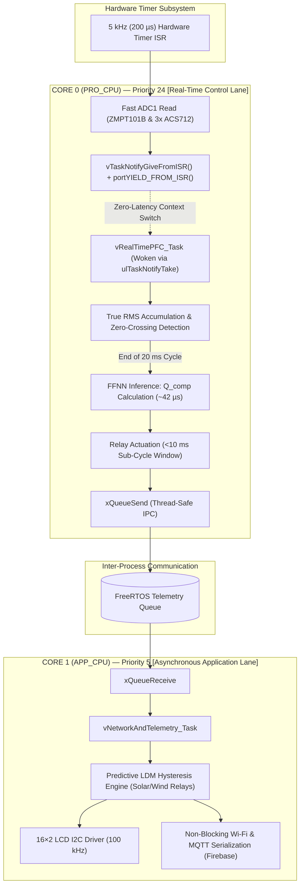

# Embedded Firmware Architecture 

This directory contains the production firmware running on the ESP32 DevKit V1 (Xtensa Dual-Core 32-bit LX6 @ 240 MHz), implementing deterministic edge control via FreeRTOS.

---

## 1. File Manifest

| File | Description | Storage Class |
|:---|:---|:---:|
| **`Dual_Core_Edge_Framework.ino`** | Main firmware integrating FreeRTOS tasks, hardware timer ISR, True RMS extraction, FFNN edge inference, dynamic LDM hysteresis, and asynchronous MQTT telemetry. | Flash / SRAM |
| **`NN_Weights.h`** | Pre-trained, quantized weight matrices and bias vectors for the Function Fitting Neural Network (FFNN). | `PROGMEM` (Flash) |

---

## 2. Real-Time Task Allocation & Deferred Interrupt Architecture

To prevent long instruction sequences from stalling low-level CPU interrupt processing, this architecture uses standard **Deferred Interrupt Processing**. 

The hardware timer ISR remains lightweight: it acquires the analog samples, writes to a shared ring buffer, and instantly unblocks the deterministic task using FreeRTOS Direct-to-Task Notifications (`vTaskNotifyGiveFromISR`). Complex floating-point calculations and neural network inference are executed strictly in task context on **Core 0**.

---

## 3. Core 0 Execution Budget (Per 200 µs Cycle)

Separating the ISR from the task ensures that interrupt latency across the entire system remains strictly under $10\ \mu\text{s}$, while the total cycle execution remains well within the $200\ \mu\text{s}$ periodic deadline:

| Execution Stage | Context | Typical Duration | Worst-Case Budget | Headroom / Margin |
|:---|:---:|:---:|:---:|:---:|
| **Hardware Timer ISR & ADC Capture** | ISR | $8\ \mu\text{s}$ | $12\ \mu\text{s}$ | — |
| **Task Notification & Context Switch** | FreeRTOS Kernel | $2\ \mu\text{s}$ | $4\ \mu\text{s}$ | — |
| **Baseline Stripping & RMS Accumulator** | `vRealTimePFC_Task` | $12\ \mu\text{s}$ | $18\ \mu\text{s}$ | — |
| **FFNN Forward-Pass (Executed at cycle boundary)** | `vRealTimePFC_Task` | $42\ \mu\text{s}$ | $58\ \mu\text{s}$ | — |
| **Relay Actuation & Queue Push** | `vRealTimePFC_Task` | $4\ \mu\text{s}$ | $8\ \mu\text{s}$ | — |
| **Combined Worst-Case Total** | **Mixed** | **$68\ \mu\text{s}$** | **$100\ \mu\text{s}$** | **$50\%\ (100\ \mu\text{s}\ \text{headroom})$** |

> **ADC Hardware Guardrail:** All analog sensor inputs are mapped strictly to **ADC1** (`GPIO 32, 33, 34, 35`). **ADC2 is intentionally unused** because the ESP32 Wi-Fi driver continuously claims ADC2 hardware resources during RF calibration and packet serialization, which invalidates concurrent analog readings.

---

## 4. Firmware Code Walkthrough (`Dual_Core_Edge_Framework.ino`)

The source code is organized into distinct execution stages:

### A. Initialization & Task Creation (`setup()`)
1. **Queue Creation:** Instantiates `xTelemetryQueue = xQueueCreate(10, sizeof(EnergyTelemetry_t))` to guarantee thread-safe metrics passing.
2. **Task Pinning:**
   - Spawns `vRealTimePFC_Task` pinned exclusively to **Core 0** (`xTaskCreatePinnedToCore`, Priority 24).
   - Spawns `vNetworkAndTelemetry_Task` pinned to **Core 1** (`xTaskCreatePinnedToCore`, Priority 5).
3. **Timer Configuration:** Sets up a hardware timer at a 1 MHz base tick with an alarm divider set to 200 ticks ($200\ \mu\text{s}$ / 5 kHz period) attached to `onTimerISR()`.

### B. Core 0: Deterministic Control Loop (`vRealTimePFC_Task`)
- **Wait on Notification:** Blocks cleanly on `ulTaskNotifyTake(pdTRUE, portMAX_DELAY)` awaiting the hardware timer trigger.
- **Waveform Accumulation:** Subtracts the zero-current ($2.5\ \text{V}$) and zero-voltage ($1.65\ \text{V}$) DC offsets, accumulating instantaneous squared values for $V_{RMS}$ and $I_{RMS}$, along with instantaneous active power $P(t)$.
- **Cycle Boundary Processing ($N = 100$ samples, $20\ \text{ms}$):**
  1. Computes True RMS values and extracts phase displacement $\theta$.
  2. Passes input features $(V_{RMS}, I_{RMS}, P, \Delta t)$ to `forwardPassFFNN()`.
  3. Evaluates predicted $Q_{comp}$ and directly updates relay GPIOs (`GPIO 18, 19`) to engage/disengage the $10\ \mu\text{F}$ capacitor banks.
  4. Packs the metrics into `EnergyTelemetry_t` and dispatches via `xQueueSend()`.

### C. Core 1: Asynchronous Services (`vNetworkAndTelemetry_Task`)
- **Queue Polling:** Reads telemetry frames non-blockingly using `xQueueReceive(xTelemetryQueue, &telemetry, pdMS_TO_TICKS(50))`.
- **Hysteresis Engine:** Checks active power against dynamic thresholds:
  - $P_{active} \ge 22\ \text{W} \rightarrow$ Activates Solar Adapter Relay.
  - $P_{active} \le 18\ \text{W} \rightarrow$ Deactivates Solar Adapter Relay.
  - $P_{active} \ge 42\ \text{W} \rightarrow$ Activates Wind/Auxiliary Adapter Relay.
  - $P_{active} \le 38\ \text{W} \rightarrow$ Deactivates Wind/Auxiliary Adapter Relay.
- **Display & Cloud Sync:** Refreshes the I2C LCD (100 kHz bus clock) and serializes real-time JSON frames to the MQTT broker without introducing jitter into Core 0.

---

## 5. Memory Footprint & Constraints

Compiled under ESP-IDF / Arduino core with compiler optimization `-O2`:

- **Flash (Program Space):** $\approx 842\ \text{KB}$ ($\approx 64\%$ of default 1.3 MB app partition).
- **Internal SRAM:** $\approx 48.2\ \text{KB}$ ($\approx 15\%$ static allocation).
- **Stack Allocation:**
  - `vRealTimePFC_Task`: $4096\ \text{bytes}$ (Sized for fast numerical arrays, zero heap fragmentation).
  - `vNetworkAndTelemetry_Task`: $8192\ \text{bytes}$ (Sized for TLS / TCP / MQTT payload assembly).