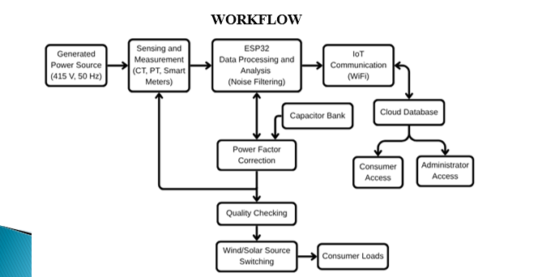

# System Architecture, Simulation & Vector Diagrams 

**Document ID:** ARCH-SIM-APFC-2026-REV2  
**Target Subsystems:** Dual-Core FreeRTOS Pipeline, MATLAB/Simulink Digital Twin, Phasor Vector Analysis  
**Classification:** Model-Based Design (MBD) & Architectural Verification Reference  

---

## Overview

This directory archives the engineering schematics, digital twin models, and system workflows that bridge theoretical formulation with physical hardware execution. The visual artifacts substantiate the Model-Based Design (MBD) workflow: validating algorithm dynamics in MATLAB/Simulink before compiling firmware for the ESP32 dual-core target.

---

## 📂 Visual Asset Index

| Asset | Subsystem / Focus | Core Technical Takeaway |
|:---|:---|:---|
| **[`Workflow.png`](./Workflow.png)** | Firmware Architecture | Dual-core FreeRTOS task partition, 5 kHz hardware timer ISR, inter-process communication (IPC), and non-blocking telemetry pipeline. |
| **[`Matlab Simulink.png`](./Matlab%20Simulink.png)** | Digital Twin Simulation | Closed-loop electrical power stage model simulating utility grid feed, dynamic inductive motor loads, and stepped capacitor compensation. |
| **[`Power Factor Analyser.png`](./Power%20Factor%20Analyser.png)** | Phasor & Power Triangle Analysis | Vector displacement diagrams ($\vec{V}$-$\vec{I}$ phase angle) and apparent power reduction before and after staged capacitive correction. |
| **[`Existing System.png`](./Existing%20System.png)** | Comparative Architecture | Architectural contrast highlighting latency bottlenecks and packet jitter in conventional cloud/SCADA-coupled APFC topologies. |

---

## 1. System Execution Pipeline (`Workflow.png`)



### Architectural Breakdown
- **Physical Core Partitioning:** Guarantees strict temporal decoupling between time-critical analog sampling on Core 0 (PRO_CPU) and variable-latency network protocols on Core 1 (APP_CPU).
- **Interrupt Servicing & Task Context:** The 5 kHz hardware timer ISR executes minimal register operations ($<10\ \mu\text{s}$) and offloads True RMS numerical integration to the high-priority task using direct-to-task notifications (`vTaskNotifyGiveFromISR()`).
- **Bounded Telemetry Buffer:** Inter-Process Communication uses a fixed-depth FreeRTOS queue (`xTelemetryQueue`) with a non-blocking timeout (`0` ticks), ensuring network latency or socket stalls on Core 1 never introduce sampling jitter into Core 0.

---

## 2. MATLAB/Simulink Digital Twin (`Matlab Simulink.png`)


### Simulation Parameters & Model Setup
- **Solver Configuration:** `ode23tb` (stiff/TR-BDF2) fixed-step solver running at a discrete sample step size of $T_s = 20\ \mu\text{s}$ ($50\text{ kHz}$) to capture switching inrush transients.
- **Source Parameters:** 230V AC RMS, 50 Hz, single-phase grid feed with nominal line impedance ($R = 0.4\ \Omega, L = 1.2\text{ mH}$).
- **Dynamic Load Cell:**
  - Base resistive load ($R = 1.5\text{ k}\Omega$).
  - Asynchronous induction machine block simulating dynamic mechanical torque loading, establishing an uncompensated power factor of $0.68\text{--}0.74$ lagging.
- **Compensation Stage:** Switched shunt capacitor branches ($10\ \mu\text{F}$ and $20\ \mu\text{F}$) coupled through controlled circuit breaker blocks modeling physical relay contact closures.

### Validation Correlation
The digital twin confirmed that switching capacitors at discrete intervals avoids resonance peaks on the 50 Hz bus, and proved that deploying the forward-pass FFNN matches analytical steady-state reactive equations with an error of $<0.5\%$.

---

## 3. Phasor & Power Triangle Analysis (`Power Factor Analyser.png`)


### Vector Transformation Metrics
This diagram illustrates the physical current displacement and power triangle transformation achieved by the edge controller:

```
Uncompensated State:                          Compensated State:
      ▲                                             ▲
      │ Real Power (P = Constant)                   │ Real Power (P = Constant)
      ├──────────────────────►                      ├──────────────────────►
      │ \                   ▲                       │ \      ▲
      │  \                  │                       │  \     │ Q_net = Q_ind - Q_cap
Apparent│   \                 │ Inductive     Apparent│   \    │ (Reduced)
Power │    \                │ Reactive      Power │    \   │
 (S1) │     \               │ Power          (S2) │     \  ▼
      │      \ θ1           │ (Q_ind)             │      \ θ2  (θ2 << θ1)
      ▼       ▼             ▼                     ▼       ▼
      Lagging PF = 0.68 - 0.74                      Corrected PF ≥ 0.96
```

- **Apparent Power Reduction:** By injecting leading reactive current ($I_c$) in quadrature with line voltage, net apparent power demand drops from $S_1 = \frac{P}{0.70}$ to $S_2 = \frac{P}{0.96}$, yielding a $\approx 27\%$ reduction in total line current draw.
- **Line Loss Mitigation:** Feeder copper losses ($I^2R$) decrease proportionally by $\approx 46\%$, directly optimizing thermal headroom in upstream switchgear.

---

## 4. Legacy vs. Edge Architectural Contrast (`Existing System.png`)


| Evaluation Parameter | Legacy Cloud / SCADA APFC (`Existing System.png`) | Proposed Dual-Core Edge Framework (`Workflow.png`) |
|:---|:---|:---|
| **Decision Processing Location** | Remote central server / Cloud database | On-chip Xtensa LX6 Core 0 (PRO_CPU) |
| **Correction Latency** | $150\text{ ms} - 2.5\text{ s}$ (dependent on network QoS) | **$20\text{--}40\text{ ms}$** ($1\text{ to }2$ complete AC cycles) |
| **Fault Resilience** | Offline if Wi-Fi or router drops connection | **Fully autonomous**; zero sampling disruption during outages |
| **Computation Model** | Heavy floating-point on server | Quantized on-device FFNN inference ($\approx 42\ \mu\text{s}$) |
| **Actuator Coordination** | Asynchronous polling loop | Deterministic sub-cycle phase timing |

---

## 5. Simulation-to-Hardware Verification Protocol

To verify correlation between the digital twin simulations and the physical bench prototype:

1. **Simulink Model Run:** Load `matlab/digital_twin_model.slx` and execute for $t = 2.0\text{ s}$. At $t = 0.5\text{ s}$, step-increase the inductive motor load. Observe transient voltage sag and power factor drop to $0.71$.
2. **Capacitor Activation:** At $t = 0.53\text{ s}$, the simulated controller fires Stage 1 ($10\ \mu\text{F}$), stabilizing the power factor to $0.91$. At $t = 0.60\text{ s}$, Stage 2 ($20\ \mu\text{F}$) engages, stabilizing the power factor at $0.97$.
3. **Hardware Bench Alignment:** Apply the equivalent physical load using the Nidec motor and 24V fan assembly. Monitor the LCD and serial telemetry to verify that the physical settling time matches the simulation within $10\text{ ms}$ (accounting for physical relay armature transit).