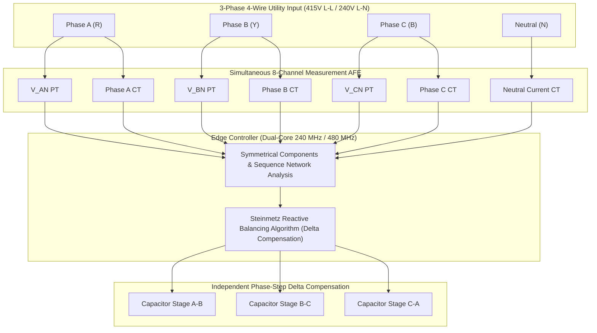

# Engineering Roadmap & Production Revision Guide (`Future_Improvements.md`)

**Document ID:** ROADMAP-APFC-LDM-2026-REV2  
**Target Platform:** Industrial ESP32-S3 / STM32H7 Architecture Migration  
**Classification:** Product Engineering Roadmap & Hardware Rev 2.0 Transition Plan  
**Target Application:** Industrial Motor Control Centers (MCC), Distributed Energy Resources (DER), and Microgrid Substation Automation  

---

## Executive Summary

While the validated bench prototype demonstrates deterministic sub-cycle Power Factor Correction (PFC) and autonomous Load Demand Management (LDM) within $1\text{ to }2\text{ AC cycles}$ ($20\text{--}40\text{ ms}$), deploying this framework into mission-critical industrial facilities (IEC 61000 / IEEE 519 compliance) requires addressing the physical constraints of prototype-grade silicon, electromechanical contact wear, and single-phase topologies.

This document details the transition path from the current proof-of-concept prototype to a **commercial, production-grade Hardware Revision 2.0**.

---

## 1. Hardware Architecture & Analog Front-End (AFE) Overhaul

```
Current Prototype (Rev 1.0)              Production Architecture (Rev 2.0)
┌──────────────────────────┐             ┌────────────────────────────────────────────────────────┐
│ ZMPT101B + ACS712-05B    │             │ Split CTs / Rogowski Coils + Precision PTs             │
└────────────┬─────────────┘             └───────────────────────────┬────────────────────────────┘
             │ (Single-point calib)                                  │ (2nd-Order Sallen-Key Anti-Aliasing)
             ▼                                                       ▼
┌──────────────────────────┐             ┌────────────────────────────────────────────────────────┐
│ ESP32 SAR ADC (12-bit)   │ ──────────► │ External 16/24-Bit Simultaneous ADC (TI ADS131M04)    │
│ INL/DNL Non-Linearity    │             │ SPI Bus, Differential Inputs, Low-Drift VREF (1.2V)    │
└────────────┬─────────────┘             └───────────────────────────┬────────────────────────────┘
             │                                                       │
             ▼                                                       ▼
┌──────────────────────────┐             ┌────────────────────────────────────────────────────────┐
│ Electromechanical Relays │             │ Back-to-Back Thyristor Switched Capacitors (TSC)       │
│ 6-9ms bounce, arc wear   │             │ Zero-Voltage Crossing Optotriac Drivers (MOC3041)      │
└──────────────────────────┘             └────────────────────────────────────────────────────────┘
```

### 1.1 Precision External Simultaneous-Sampling ADC
* **Current Limitation:** The ESP32's internal 12-bit Successive Approximation Register (SAR) ADC exhibits non-linear response profiles below $0.15\text{V}$ and above $3.15\text{V}$, introducing up to $15\%$ measurement error at light load currents ($<150\text{ mA RMS}$). Furthermore, sequential sampling across channels introduces an inherent inter-channel phase skew.
* **Rev 2.0 Implementation:**
  * Integrate an external **4-channel, 24-bit simultaneous-sampling Sigma-Delta ($\Sigma\Delta$) ADC** (e.g., Texas Instruments **ADS131M04** or Microchip **MCP3911**) over a high-speed $20\text{ MHz}$ SPI interface.
  * Incorporate an ultra-low drift ($<5\text{ ppm/}^\circ\text{C}$) precision external voltage reference (e.g., **REF5025**).
  * Enforce fully differential analog input routing to reject common-mode electromagnetic interference (EMI) originating from industrial variable frequency drives (VFDs).

### 1.2 Active Analog Anti-Aliasing & Signal Conditioning
* **Current Limitation:** Prototype signal conditioning relies on raw resistive dividers and firmware software blanking, making high-frequency motor brush noise and inverter PWM switching transients vulnerable to aliasing into the $5\text{ kHz}$ sampling band.
* **Rev 2.0 Implementation:**
  * Implement an active **2nd-order Sallen-Key low-pass Butterworth filter** stage per channel utilizing low-noise, rail-to-rail operational amplifiers (e.g., **OPA2320** or **MCP6002**):

    $$f_c = \frac{1}{2\pi \sqrt{R_1 R_2 C_1 C_2}} \approx 1.50\text{ kHz}$$

  * This configuration provides flat passband response across the fundamental ($50\text{ Hz}$) and key power quality harmonics up to the 25th order ($1250\text{ Hz}$), while attenuating high-frequency noise prior to ADC digitization.

### 1.3 Solid-State Thyristor-Switched Capacitors (TSC)
* **Current Limitation:** Electromechanical relays introduce $6\text{--}9\text{ ms}$ of contact travel time, produce mechanical contact bounce ($2\text{--}4\text{ ms}$), and suffer from contact pitting and degradation under continuous capacitive inrush currents.
* **Rev 2.0 Implementation:**
  * Transition from mechanical armatures to solid-state **Thyristor-Switched Capacitors (TSC)** utilizing back-to-back Silicon Controlled Rectifiers (SCRs) or Triacs (e.g., STMicroelectronics **BTA16-800BW / BTA24**).
  * Drive thyristor gates using **Zero-Crossing Optoisolated Triac Drivers** (e.g., **MOC3041** / **VO4156**). 
  * Enforce hardware-synchronized firing strictly at the utility voltage zero-differential point ($dv/dt = 0$), completely eliminating capacitive turn-on inrush current transients, contact erosion, and acoustic switching noise.
  * **Thermal Dissipation Architecture:** Thyristors will require appropriately sized extruded aluminum heatsinks with thermal interface material (TIM, $\ge 3.0\ \text{W/m}\cdot\text{K}$), as continuous reactive current flow across semiconductor forward-voltage drops ($V_F \approx 1.2\text{--}1.5\text{V}$) generates significant conduction losses ($P_{loss} \approx V_F \cdot I_{RMS}$) without the mechanical isolation of zero-resistance relay contacts.

---

## 2. Advanced Power Quality Analytics & Firmware Intelligence

### 2.1 On-Chip Harmonic Decomposition & Total Harmonic Distortion (THD)
* **Objective:** Expand beyond basic displacement power factor ($\cos\theta$) to measure true power factor under non-linear distortion loads in compliance with **IEEE 519-2022**.
* **Firmware Implementation:**
  * Deploy a 128-point or 256-point radix-2 Fast Fourier Transform (FFT) leveraging the hardware-accelerated **ESP-DSP** vector processing library on the Xtensa LX6/LX7 SIMD instruction pipeline.
  * Extract discrete harmonic magnitudes up to the 15th harmonic ($750\text{ Hz}$):
    
    $$THD_V = \frac{\sqrt{\sum_{h=2}^{15} V_h^2}}{V_1} \times 100\%, \qquad THD_I = \frac{\sqrt{\sum_{h=2}^{15} I_h^2}}{I_1} \times 100\%$$

  * Calculate True Power Factor ($PF_{true}$) combining displacement and distortion components:

    $$PF_{true} = \frac{P}{S} = \frac{1}{\sqrt{1 + THD_I^2}} \times \cos(\theta_1)$$

### 2.2 Fine-Grain Dynamic Compensation (Hybrid APFC / Active Filter)
* **Objective:** Replace discrete $10\ \mu\text{F}$ stepped stages with continuous, infinitely variable reactive power compensation.
* **Firmware Implementation:**
  * Implement a **Static VAR Compensator (SVC)** combining a fixed capacitor bank with a **Thyristor-Controlled Reactor (TCR)**.
  * Modulate the firing angle ($\alpha$, from $90^{\circ}$ to $180^{\circ}$) relative to the AC voltage crest using hardware timer capture-compare interrupts to continuously adjust net reactive VAR injection:

    $$B_{TCR}(\alpha) = \frac{2(\pi - \alpha) + \sin(2\alpha)}{\pi \omega L}$$

---

## 3. Industrial Communications & Fieldbus Interfaces

While MQTT over Wi-Fi is suitable for commercial IoT telemetry, industrial manufacturing floors prohibit non-deterministic wireless communication for closed-loop control.

```
                    ┌──────────────────────────────────────────────┐
                    │      Industrial Rev 2.0 Communication Hub    │
                    └──────────────────────┬───────────────────────┘
                                           │
         ┌─────────────────────────────────┼─────────────────────────────────┐
         ▼                                 ▼                                 ▼
┌──────────────────┐             ┌──────────────────┐             ┌──────────────────┐
│ Isolated RS-485  │             │ Industrial CAN   │             │ Industrial Ether │
│ Modbus RTU Slave │             │ CANopen / J1939  │             │ Modbus TCP /     │
│ (ISO1410 /       │             │ (SN65HVD230 /    │             │ MQTT over TLS    │
│ MAX13487E)       │             │ MCP2515 SPI)     │             │ (W5500 SPI MAC)  │
└──────────────────┘             └──────────────────┘             └──────────────────┘
```

### 3.1 Galvanically Isolated RS-485 (Modbus RTU)
* Deploy a fully isolated RS-485 transceiver (e.g., **TI ISO1410** or **Analog Devices ADM2587E**) with integrated isolated DC-DC power conversion.
* Implement a compliant **Modbus RTU Slave** memory map exposing:
  * Holding Registers (40001–40020): Line Voltage, Phase Currents, Active/Reactive/Apparent Power, Power Factor.
  * Coil Registers (00001–00008): Manual override states for capacitor stages and auxiliary load relays.
  * Input Status Registers (10001–10008): MCB status, thermal trip sensor, and brownout flag logs.

### 3.2 Industrial CAN Bus (ISO 11898-2)
* Interface the internal ESP32 Two-Wire Automotive Controller (TWAI) with a high-speed CAN transceiver (e.g., **SN65HVD230** or isolated **ISO1050**).
* Establish periodic broadcast messaging ($100\text{ ms}$ cadence) compatible with **CANopen** or **SAE J1939** standards for seamless telemetry aggregation into automotive plant automation and Battery Management Systems (BMS).

### 3.3 Hardwired Industrial Ethernet
* Integrate a hardwired Ethernet interface (e.g., **Wiznet W5500** SPI controller or LAN8720A RMII PHY) to eliminate Wi-Fi dropouts in electrically noisy, high-voltage switchgear environments.

---

## 4. Power Stage & Polyphase Expansion (Three-Phase Topology)

The current architecture validates single-phase balancing. Scaling to industrial primary distribution requires a balanced/unbalanced 3-Phase 4-Wire ($415\text{V}_{L-L} / 240\text{V}_{L-N}$) topology.



* **Steinmetz Circuit Balancing:** Under unbalanced load conditions, equal three-phase capacitor switching causes overvoltage on lightly loaded lines and negative-sequence circulation. Rev 2.0 enforces sequence decomposition using symmetrical components to feed the **Steinmetz balancing algorithm**, resolving independent delta-connected admittances ($B_{AB}, B_{BC}, B_{CA}$) to balance real phase demand while eliminating reactive current draw.
* **Vector Control Consideration:** While Clarke/Park transformations ($\alpha\beta0 \to dq$) are reserved for future active power filter (APF) inverter stages, the Steinmetz sequence approach provides deterministic, low-overhead reactive switching ideally suited for delta-switched capacitor banks.

---

## 5. Hardware Reliability, Enclosure & Production Standards

### 5.1 PCB Layout & Signal Integrity Standards
* **4-Layer High-Reliability PCB Stackup:**
  * Layer 1 (Top): High-speed digital signals, crystal routing, and low-level analog traces.
  * Layer 2 (Inner 1): Continuous, uninterrupted Ground Plane (split into Analog AGND and Digital DGND, bridged exclusively at a single star ferrite bead node).
  * Layer 3 (Inner 2): Split Power Planes ($3.3\text{V}$ Logic, $5\text{V}$ Analog, $12\text{V}$ Actuator).
  * Layer 4 (Bottom): High-voltage AC mains routing and relay power tracks.
* **Creepage and Clearance Compliance:** Maintain $\ge 6.3\text{ mm}$ creepage distance between AC mains traces and low-voltage DC logic planes to meet **IEC 61010-1 (Pollution Degree 2, Overvoltage Category III)** safety specifications.
* **High-Current Bus Bars:** Replace PCB copper traces on load lines with unmasked, tin-plated copper tracks or heavy copper pours ($\ge 2\text{ oz/ft}^2$) reinforced with solid solder build-up to sustain continuous $16\text{A}$ loads without localized thermal rise.

### 5.2 Industrial Enclosure & Environmental Protection
* Packaging: Enclosed in a flame-retardant **UL94-V0 polycarbonate / ABS DIN-Rail enclosure** (standard 6-module or 9-module width, $35\text{ mm}$ mounting).
* Terminal Blocks: Heavy-duty rising-cage screw terminals rated for $600\text{V} / 32\text{A}$ accepting up to $4\text{ mm}^2$ (10 AWG) wiring.
* Ingress Protection: IP51 dust and drip resistance for integration within industrial Motor Control Centers (MCC).

---

## 6. Embedded Cybersecurity & Operational Safety

| Vulnerability Vector | Production Risk | Mitigation Mechanism in Rev 2.0 |
|:---|:---|:---|
| **Firmware Tampering** | Malicious binary modification disabling safety shutoff. | Enable **ESP32 Secure Boot v2** utilizing hardware RSA-3072 signature verification. |
| **Physical Flash Extraction** | Reverse-engineering proprietary FFNN weights and configurations. | Enforce **Hardware Flash Encryption (AES-XTS-256)** via permanent hardware eFuse burning. |
| **Man-In-The-Middle Telemetry** | Falsification of energy audit logs and MQTT switching commands. | Enforce **TLS v1.3 with X.509 Mutual Authentication (mTLS)** for all cloud/broker handshakes. |
| **Firmware Update Corruption** | Bricking devices during field updates over weak connections. | Implement **Dual-Partition A/B OTA Engine** with automatic fallback rollback on failed integrity verification. |

---

## 7. Development Milestones & Phased Execution Plan

```
Q1 2027: Analog & Power Stage R&D
 ├── Design & simulate 2nd-order Sallen-Key AFE filter stages.
 ├── Validate ADS131M04 24-bit simultaneous ADC over high-speed SPI.
 └── Prototype back-to-back Triac (BTA24) zero-cross switching circuits with thermal heatsinks.

Q2 2027: Custom PCB Rev 2.0 Fabrication
 ├── Layout 4-layer mixed-signal board adhering to IEC 61010-1 creepage rules.
 ├── Integrate isolated RS-485 Modbus RTU and CANopen transceivers.
 └── Fabricate and assemble 5 pilot test units for environmental bench stress testing.

Q3 2027: Advanced Firmware & Polyphase Validation
 ├── Port FreeRTOS firmware to ESP32-S3 / STM32H7 dual-core architecture.
 ├── Implement ESP-DSP accelerated 128-point FFT for THD extraction.
 └── Validate Steinmetz unbalanced reactive power equations in 3-phase hardware test cell.

Q4 2027: Field Compliance & Certification Testing
 ├── Conduct conducted/radiated EMI stress testing (EN 55032 / IEC 61000-6-2).
 ├── Execute 1000-hour continuous thermal endurance test under rated inductive load.
 └── Finalize commercial production manufacturing documentation.
```