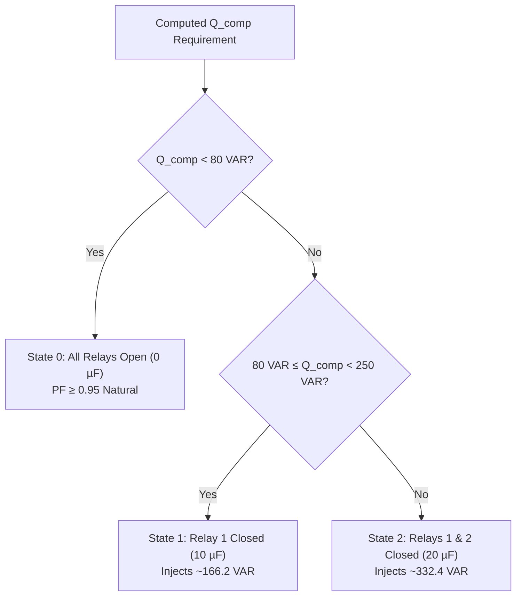

# Mathematical Formulation & Operational Principle 

This document provides the foundational engineering principles, discrete-time mathematics, neural network edge-inference mechanisms, and FreeRTOS task synchronization models governing the **Dual-Core Edge Computing Framework for Power Factor Correction (PFC) and Load Demand Management (LDM)**.

---

## 1. Edge Operational Philosophy

In industrial facilities and localized microgrids, operating dynamic inductive loads (e.g., fractional-horsepower motors, ventilation blowers, compressors) introduces instantaneous phase displacement between the voltage and current waveforms. 

Conventional automated power factor correction (APFC) systems rely either on centralized electromechanical controllers or cloud-coupled IoT architectures. These implementations exhibit significant operational bottlenecks:
- **Cloud Latency & Packet Jitter:** Transmitting raw ADC frames over TCP/IP introduces transport latencies of $100\text{--}500\text{ ms}$, rendering real-time sub-cycle compensation physically impossible.
- **Single-Point Failure Vulnerability:** Intermittent Wi-Fi drops or cloud gateway timeouts cause actuator stalls or uncontrolled relay hunting.
- **Electromechanical Stress:** Switching reactive capacitor stages without deterministic sub-cycle phase timing causes transient inrush currents ($I_{peak} \gg 10 \times I_n$) and accelerated contact erosion.

This edge framework eliminates the network dependency by co-locating deterministic analog acquisition, non-transcendental neural network inference, and sub-cycle actuation directly within the **ESP32 Xtensa LX6 dual-core processor**, achieving complete correction within $1\text{ to }2\text{ AC cycles}$ ($20\text{--}40\text{ ms}$).

---

## 2. Dual-Core RTOS Architecture & Execution Pipeline

The firmware partitions high-speed deterministic acquisition from asynchronous communications by binding tasks to dedicated physical cores using FreeRTOS primitives.

```mermaid
flowchart TD
    subgraph HW_INTERRUPT["Deterministic Hardware Timing (Core 0)"]
        TimerISR["Hardware Timer ISR (5.0 kHz / 200 µs Period)"]
    end

    subgraph CORE0_PIPELINE["Core 0 (PRO_CPU) — Priority 24 [Real-Time Control Lane]"]
        ADC_Read["Multi-Channel ADC1 Read (ZMPT101B & 3x ACS712)"]
        NotifyTask["Direct Task Notification: vTaskNotifyGiveFromISR()"]
        TaskControl["vRealTimePFC_Task (Context Switched)"]
        
        SubSample["DC Baseline Removal (1.65V & 2.5V Offsets)"]
        Accumulator["Discrete RMS & Instantaneous Power Accumulation"]
        ZeroCross["Zero-Crossing Phase Detection & Filter Window"]
        
        BoundaryCheck{"20 ms Cycle Complete? (N = 100 Samples)"}
        CalcRMS["Compute True RMS: V_RMS, I_RMS, P, S, cos(θ)"]
        FFNN_Inference["Forward-Pass FFNN Inference (~42 µs Budget)"]
        ActuateRelay["Relay Driver Evaluation (<10 ms Decision Window)"]
        QueueSend["xQueueOverwrite() / Timeout = 0 (Thread-Safe IPC)"]
    end

    subgraph RTOS_QUEUE["FreeRTOS Telemetry Queue"]
        IPC_Buffer[("xTelemetryQueue (Depth = 10 Frames)")]
    end

    subgraph CORE1_PIPELINE["Core 1 (APP_CPU) — Priority 5 [Asynchronous Application Lane]"]
        TaskNetwork["vNetworkAndTelemetry_Task"]
        QueueReceive["xQueueReceive(pdMS_TO_TICKS(50))"]
        Hysteresis["Dynamic LDM Hysteresis Engine (Active Power P)"]
        RelayLDM["Switch Auxiliary / Renewable Adapters (20W / 40W)"]
        LCD_Driver["Update 16×2 Character LCD via I2C (100 kHz Bus)"]
        MQTT_Client["JSON Serialization & Non-Blocking MQTT Dispatch"]
    end

    %% Execution Sequences
    TimerISR --> ADC_Read
    ADC_Read --> NotifyTask
    NotifyTask -.->|Zero-Latency Context Switch| TaskControl
    TaskControl --> SubSample
    SubSample --> Accumulator
    Accumulator --> ZeroCross
    ZeroCross --> BoundaryCheck
    BoundaryCheck -- No --> TaskControl
    BoundaryCheck -- Yes --> CalcRMS
    CalcRMS --> FFNN_Inference
    FFNN_Inference --> ActuateRelay
    ActuateRelay --> QueueSend

    QueueSend --> IPC_Buffer
    IPC_Buffer --> QueueReceive
    QueueReceive --> TaskNetwork
    TaskNetwork --> Hysteresis
    Hysteresis --> RelayLDM
    RelayLDM --> LCD_Driver
    LCD_Driver --> MQTT_Client
```



---

## 3. Discrete-Time Signal Processing Mathematics

The system continuously samples the analog channels at a fixed sampling frequency $f_s = 5.0\text{ kHz}$ ($T_s = 200\ \mu\text{s}$). For a nominal $50\text{ Hz}$ utility grid, one complete electrical AC cycle spans exactly $T = 20.0\text{ ms}$, yielding $N = 100$ discrete samples per observation window:

$$N = \frac{T}{T_s} = \frac{20\text{ ms}}{200\ \mu\text{s}} = 100\ \text{samples}$$

### 3.1 DC Baseline Stripping
The raw ADC values are converted into instantaneous voltages across the scaled sensing rails. Because the AC transducers output signals centered on DC biases ($V_{bias} \approx 1.65\text{ V}$ for ZMPT101B and $V_{bias} \approx 2.50\text{ V}$ for the ACS712), instantaneous AC physical quantities are extracted via offset stripping:

$$v[k] = \left( V_{raw}[k] - V_{offset} \right) \times K_v$$

$$i[k] = \left( I_{raw}[k] - I_{offset} \right) \times K_i$$

Where:
- $V_{offset}, I_{offset}$ represent runtime-calibrated zero-crossing quiescent offsets.
- $K_v$ is the potential transformer scaling constant ($\text{V/LSB}$).
- $K_i$ is the Hall-effect transducer sensitivity constant ($\text{A/LSB}$).

### 3.2 True RMS Discrete-Time Numerical Integration
To maintain high accuracy in the presence of non-linear loads and harmonic distortion (where sinusoidal crest factor assumptions fail), True RMS values are computed using discrete integration:

$$V_{RMS} = \sqrt{\frac{1}{N} \sum_{k=1}^{N} \left( v[k] \right)^2}$$

$$I_{RMS} = \sqrt{\frac{1}{N} \sum_{k=1}^{N} \left( i[k] \right)^2}$$

### 3.3 Active Power, Apparent Power, and Displacement Power Factor
Instantaneous real power $p[k] = v[k] \cdot i[k]$ is integrated over the 100-sample boundary to yield True Active Power ($P$):

$$P = \frac{1}{N} \sum_{k=1}^{N} v[k] \cdot i[k]$$

Apparent Power ($S$) and Displacement Power Factor ($PF$) are directly derived:

$$S = V_{RMS} \times I_{RMS}$$

$$PF = |\cos(\theta)| = \frac{P}{S} = \frac{\frac{1}{N} \sum_{k=1}^{N} v[k] \cdot i[k]}{\sqrt{\frac{1}{N} \sum_{k=1}^{N} (v[k])^2} \times \sqrt{\frac{1}{N} \sum_{k=1}^{N} (i[k])^2}}$$

### 3.4 Phase Angle Extraction & Zero-Crossing Debounce
The phase displacement angle $\theta$ is extracted by measuring the temporal shift $\Delta t$ between the upward zero-crossing transition of the voltage waveform and the corresponding upward zero-crossing transition of the load current waveform:

$$\theta = \omega \cdot \Delta t = 2\pi f \cdot \Delta t$$

```
Voltage v(t)   ───┬───────/───────┬───────────────
                  │      /        │
                  │     /  Δt     │
Current i(t)   ───┼────/───/──────┼───────────────
                  │   /   /       │
                  ◄───┴──/────────►
                       20 ms
```

> **Noise Mitigation:** To eliminate false transitions triggered by harmonic ringing, line notches, or relay contact bounce, an arming lock-out window of $14\text{ ms}$ is enforced in firmware following every valid zero-crossing. Any threshold crossing occurring inside this deadband is discarded.

---

## 4. Reactive Compensation & Stepped Capacitor Dynamics

### 4.1 Theoretical Compensation Requirement
When driving an inductive load with lagging power factor $\cos(\theta_1)$, the active power component remains $P$, while reactive power demand is:

$$Q_1 = P \cdot \tan(\theta_1)$$

To correct the system to an optimal target power factor $\cos(\theta_2) \ge 0.96$ (where $\theta_2 \le 16.2^{\circ}$), the residual reactive power is:

$$Q_2 = P \cdot \tan(\theta_2)$$

The exact net reactive power injection ($Q_{comp}$) required from the capacitor bank is:

$$Q_{comp} = Q_1 - Q_2 = P \left[ \tan(\theta_1) - \tan(\theta_2) \right]$$

### 4.2 Stepped Parallel Capacitor Bank Control
The physical hardware incorporates two $10\ \mu\text{F} \pm 5\%$ Metallized Polypropylene Motor Run AC Capacitors (IEC 60252-1 CBB61/CBB65 type). The reactive VAR supplied by an AC capacitor of capacitance $C$ at grid voltage $V_{RMS}$ and angular frequency $\omega = 2\pi f$ is:

$$Q_C = \omega C V_{RMS}^2 = 2\pi (50\text{ Hz}) \cdot C \cdot (230\text{ V})^2 \approx 16.619 \times 10^6 \times C$$

The available discrete compensation states are structured as follows:

| Compensation State | Engaged Relays | Effective Capacitance ($C_{eff}$) | Reactive Power Injection ($Q_{VAR}$ @ 230V, 50Hz) | Operational Target Window |
|:---:|:---:|:---:|:---:|:---|
| **Stage 0 (Bypass)** | None (Relays OFF) | $0\ \mu\text{F}$ | $0.0\ \text{VAR}$ | Natural Load $PF \ge 0.95$ |
| **Stage 1 (Single)** | Relay 1 ON | $10\ \mu\text{F}$ | $\approx 166.2\ \text{VAR}$ | $80\ \text{VAR} \le Q_{comp} < 250\ \text{VAR}$ |
| **Stage 2 (Parallel)** | Relays 1 & 2 ON | $20\ \mu\text{F}$ | $\approx 332.4\ \text{VAR}$ | $Q_{comp} \ge 250\ \text{VAR}$ |



---

## 5. Function Fitting Neural Network (FFNN) Edge Inference

### 5.1 Motivation for On-Device Neural Inference
Calculating $Q_{comp} = P [\tan(\arccos(PF)) - \tan(\theta_{target})]$ requires executing transcendental trigonometric algorithms (`acos`, `tan`, `sqrt`). On an embedded microcontroller lacking a dedicated hardware vector math unit:
- Transcendental floating-point routines consume non-deterministic CPU clock cycles ($120\text{--}180\ \mu\text{s}$), creating significant timing jitter within real-time control loops.
- A pre-trained, quantized feedforward neural network computes matrix multiply-accumulate (MAC) routines with deterministic execution latency ($\approx 42\ \mu\text{s}$), leaving over $50\%$ execution margin before the next sampling cycle.

### 5.2 Network Architecture & Mathematical Formulation
The neural model is a compact multi-layer perceptron (MLP) trained to learn the direct mapping between acquired physical parameters and required compensation:

```
Input Vector [x]               Hidden Layer [a]                 Output [y]
 (4 Features)               (10 Tanh Neurons)                 (1 Target)
   ┌────┐
   │VRMS├────────┐           ┌──────────────┐
   └────┘        ├──────────►│ tanh(W1·x+b1)├──┐
   ┌────┐        │           └──────────────┘  │
   │IRMS├────────┼──────────►┌──────────────┐  │              ┌────────────┐
   └────┘        │           │ tanh(W1·x+b1)├──┼─────────────►│ W2·a + b2  │──► Q_comp
   ┌────┐        ├──────────►└──────────────┘  │              └────────────┘
   │ P  ├────────┤                  ⋮          │
   └────┘        │           ┌──────────────┐  │
   ┌────┐        └──────────►│ tanh(W1·x+b1)├──┘
   │ Δt ├───────────────────►└──────────────┘
   └────┘
```

1. **Input Layer ($4 \times 1$):**
   $$\mathbf{x} = \begin{bmatrix} V_{RMS} & I_{RMS} & P & \Delta t \end{bmatrix}^T$$

2. **Hidden Layer ($10 \times 1$):**
   $$\mathbf{z}_1 = \mathbf{W}_1 \mathbf{x} + \mathbf{b}_1$$
   $$\mathbf{a}_1 = \tanh(\mathbf{z}_1) = \frac{e^{\mathbf{z}_1} - e^{-\mathbf{z}_1}}{e^{\mathbf{z}_1} + e^{-\mathbf{z}_1}}$$
   Where $\mathbf{W}_1$ is the $10 \times 4$ weight matrix and $\mathbf{b}_1$ is the $10 \times 1$ bias vector.

3. **Output Layer ($1 \times 1$):**
   $$\hat{y} = Q_{comp} = \mathbf{W}_2 \mathbf{a}_1 + b_2$$
   Where $\mathbf{W}_2$ is the $1 \times 10$ weight matrix and $b_2$ is the scalar output bias.

### 5.3 Offline Training & Verification Metrics
The model was synthesized and verified against empirical test logs and MATLAB/Simulink digital twin simulations:
- **Training Algorithm:** Levenberg-Marquardt backpropagation with Bayesian regularization.
- **Dataset Size:** 15,000 synthesized and physical transient frames across varying $R\text{-}L$ load combinations.
- **Mean Squared Error (MSE):** $0.00511$ on test set validation.
- **Regression Coefficient ($R$):** $1.0000$ across all operational domains.
- **Storage Profile:** Weight matrices compiled into `Code/NN_Weights.h` in program flash (`PROGMEM`), requiring zero dynamic RAM heap allocations.

---

## 6. Load Demand Management (LDM) Hysteresis State Machine

Core 1 continuously assesses system-wide active power consumption ($P$) to balance grid draw by dispatching simulated distributed energy resources (DERs):
- **Stage 1 Auxiliary Source:** Simulated Solar Generation Adapter.
- **Stage 2 Auxiliary Source:** Simulated Wind Generation / Grid-tied secondary line.

### 6.1 Relay Chatter & Limit-Cycle Prevention
Direct comparison against single power thresholds causes relay chatter and contact pitting when physical load demand hovers near switching boundaries. Core 1 implements a **deadband hysteresis engine** with asymmetric turn-on and turn-off limits:

```
Active Power (W)
  ▲
  │                                    Engage Wind / Aux Adapter
42├─── ─ ─ ─ ─ ─ ─ ─ ─ ─ ─ ─ ─ ─ ─ ─ ─ ─ ─ ─► [TURN ON]
  │                                           ▲
40├─── Threshold 2 (Nominal)                  │ Deadband: 4 Watts
  │                                           ▼ [TURN OFF]
38├─── ─ ─ ─ ─ ─ ─ ─ ─ ─ ─ ─ ─ ─ ─ ─ ─ ─ ─ ─►
  │
  │                                    Engage Solar Adapter
22├─── ─ ─ ─ ─ ─ ─ ─ ─ ─ ─ ─ ─ ─ ─ ─ ─ ─ ─ ─► [TURN ON]
  │                                           ▲
20├─── Threshold 1 (Nominal)                  │ Deadband: 4 Watts
  │                                           ▼ [TURN OFF]
18├─── ─ ─ ─ ─ ─ ─ ─ ─ ─ ─ ─ ─ ─ ─ ─ ─ ─ ─ ─►
  │
  │   Primary Grid Baseline Only
0 └───┴────────────────────────────────────────► Time (t)
```

### 6.2 State Transition Equations
Let $S_{solar} \in \{0, 1\}$ and $S_{wind} \in \{0, 1\}$ represent the relay contact states. The transition logic evaluates on each telemetry dequeue:

$$S_{solar}[t] = \begin{cases} 
1 & \text{if } P[t] \ge 22.0\text{ W} \\ 
0 & \text{if } P[t] \le 18.0\text{ W} \\ 
S_{solar}[t-1] & \text{if } 18.0\text{ W} < P[t] < 22.0\text{ W} 
\end{cases}$$

$$S_{wind}[t] = \begin{cases} 
1 & \text{if } P[t] \ge 42.0\text{ W} \\ 
0 & \text{if } P[t] \le 38.0\text{ W} \\ 
S_{wind}[t-1] & \text{if } 38.0\text{ W} < P[t] < 42.0\text{ W} 
\end{cases}$$

---

## 7. System Latency & Closed-Loop Response Budget

The complete physical response time from the inception of an inductive load step to steady-state corrected current flow spans between **$20\text{ ms}$ and $35\text{ ms}$**, fully resolving within $1\text{ to }2\text{ AC cycles}$:

| Stage | Process Description | Latency Window | Running Total |
|:---:|:---|:---:|:---:|
| **1** | Inductive load switched online (phase shift emerges) | $t = 0\ \text{ms}$ | $0.0\ \text{ms}$ |
| **2** | Hardware timer discrete sampling ($100$ samples @ $5\text{ kHz}$) | $20.0\ \text{ms}$ | $20.0\ \text{ms}$ |
| **3** | True RMS extraction and phase parameter computation | $0.015\ \text{ms}$ | $20.015\ \text{ms}$ |
| **4** | Feedforward FFNN inference on Core 0 | $0.042\ \text{ms}$ | $20.057\ \text{ms}$ |
| **5** | Microcontroller GPIO level shift | $0.002\ \text{ms}$ | $20.059\ \text{ms}$ |
| **6** | PC817 optocoupler driver turn-on propagation delay | $0.005\ \text{ms}$ | $20.064\ \text{ms}$ |
| **7** | Mechanical relay armature travel and contact closure | $6.0\text{--}9.0\ \text{ms}$ | $26.0\text{--}29.0\ \text{ms}$ |
| **8** | Contact bounce dissipation & steady-state reactive flow | $2.0\text{--}4.0\ \text{ms}$ | **$28.0\text{--}33.0\ \text{ms}$** |

```
[Transient Inception] 
   └── 0 to 20 ms ────► Signal Integration (1 full AC cycle)
   └── +0.06 ms ──────► Deterministic Software Inference & Actuation Trigger
   └── +8 to 13 ms ───► Optocoupler & Mechanical Relay Settling
[Steady-State Power Factor Restored: ~28 to 33 ms]
```

This deterministic timing guarantees that industrial grid standards are fully upheld without loading supervisory plant networks.