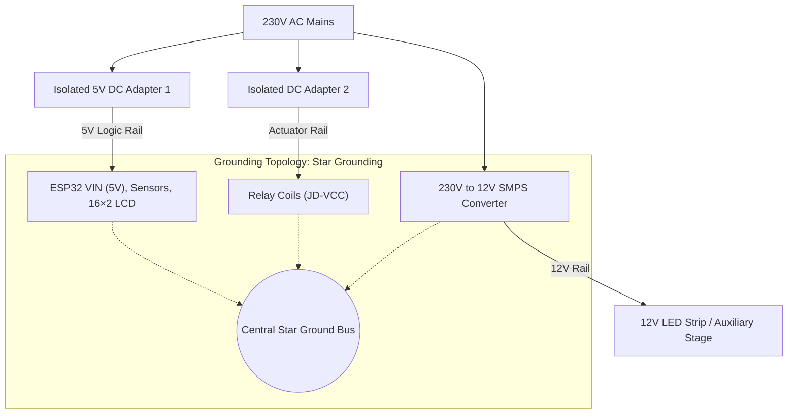

# System Interconnection & Wiring Documentation

This document details the complete hardware interconnects, GPIO allocations, high-voltage AC routing, and signal conditioning interfaces for the ESP32-based Power Monitoring and Automated Power Factor Correction (APFC) system.

---

## System Architecture Diagram

```mermaid
flowchart TD
    subgraph AC_MAINS["AC Mains 230V / 50Hz"]
        Inlet["2-Pin AC Mains Inlet"] --> MCB["MCB (6A/10A Protection)"]
        MCB --> MasterRelay["Single-Channel Relay 1 (Master Trip)"]
        MasterRelay --> AC_BUS["Regulated AC Live Bus"]
        Inlet --> NEUTRAL_BUS["Common Neutral Bus"]
    end

    subgraph SENSING["Sensing Subsystem"]
        AC_BUS --> ZMPT["ZMPT101B Voltage Transformer"]
        NEUTRAL_BUS --> ZMPT
        AC_BUS --> ACS_Total["ACS712 (Ch 3: Total Load Current)"]
    end

    subgraph LOAD_STAGE["Load & Compensation Switching Stage"]
        ACS_Total --> Relays_4Ch["4-Channel Relay Module"]
        ACS_Total --> ACS_Ind["ACS712 (Ch 2: Inductive Branch)"]
        ACS_Total --> ACS_Res["ACS712 (Ch 1: Resistive Branch)"]
        
        Relays_4Ch -->|Stage 1| Cap1["10 µF AC Capacitor Bank 1"]
        Relays_4Ch -->|Stage 2| Cap2["10 µF AC Capacitor Bank 2"]
        Cap1 --> NEUTRAL_BUS
        Cap2 --> NEUTRAL_BUS

        ACS_Ind --> IndLoads["Nidec Motor & 24V DC Fan Assembly"]
        ACS_Res --> SMPS["230V to 12V Step-Down SMPS"] --> LED["12V LED Strip (15 cm)"]
    end

    subgraph CONTROLLER["ESP32 DevKit V1 (Edge Controller)"]
        ESP32["ESP32 Microcontroller (Dual-Core LX6)"]
    end

    subgraph POWER_GROUND["Power Distribution & Star Ground"]
        Adapter1["5V DC Adapter (Logic Rail)"] --> ESP32
        Adapter2["Isolated DC Adapter (Actuator Rail)"] -->|JD-VCC| Relays_4Ch
        StarGND(("Central Star Ground Bus"))
    end

    %% Sensor to ADC Connections
    ZMPT -->|GPIO 34 (ADC1_CH6)| ESP32
    ACS_Res -->|GPIO 35 via Divider| ESP32
    ACS_Ind -->|GPIO 32 via Divider| ESP32
    ACS_Total -->|GPIO 33 via Divider| ESP32

    %% Relay Actuation
    ESP32 -->|GPIO 18, 19, 23, 5| Relays_4Ch
    ESP32 -->|GPIO 4, 15| SingleRelays["Single-Channel Relays"]

    %% Visual Telemetry
    ESP32 -->|I2C: SDA (GPIO 21) / SCL (GPIO 22)| LCD["16×2 LCD with I2C Backpack"]

    %% Grounding References
    ESP32 -.-> StarGND
    ZMPT -.-> StarGND
    ACS_Res -.-> StarGND
    ACS_Ind -.-> StarGND
    ACS_Total -.-> StarGND
    Adapter1 -.-> StarGND
    Adapter2 -.-> StarGND
```

---

## 1. Electrical Domain Partitioning

To prevent electromagnetic interference (EMI) from inductive switching and to eliminate transient coupling into analog acquisition lines, the circuit is divided into three isolated domains:

1. **High-Voltage AC Domain (230V AC, 50 Hz):** Mains inlet, MCB, ZMPT101B input transformer, relay contact stages, AC motor, and power factor compensation capacitors.
2. **Intermediate DC Load Domain (12V / 24V DC):** Auxiliary loads including the Nidec motor, 24V brushless DC cooling fan, and 12V resistive LED strip powered via the step-down SMPS module.
3. **Low-Voltage Logic & Sensing Domain (5V & 3.3V DC):** ESP32 microcontroller, I2C bus, optocoupler input triggers, and filtered sensor analog outputs.

---

## 2. ESP32 Pin Allocation Map

> **Note:** All analog sensor inputs are mapped to **ADC1** pins (GPIO 32–39). ADC2 pins are intentionally left unassigned to prevent hardware conflicts during active Wi-Fi and Bluetooth telemetry transmission.

| ESP32 Pin | Function / Mode | Connected Device | Peripheral Pin | Notes |
|:---|:---|:---|:---|:---|
| **GPIO 34** | Analog Input (ADC1_CH6) | ZMPT101B Voltage Module | `OUT` | Input-only pin; AC voltage waveform sampling |
| **GPIO 35** | Analog Input (ADC1_CH7) | ACS712 Module 1 | `OUT` | Channel 1: Resistive Load Current ($I_1$) via divider |
| **GPIO 32** | Analog Input (ADC1_CH4) | ACS712 Module 2 | `OUT` | Channel 2: Inductive Load Current ($I_2$) via divider |
| **GPIO 33** | Analog Input (ADC1_CH5) | ACS712 Module 3 | `OUT` | Channel 3: Total / Compensated Current ($I_{total}$) via divider |
| **GPIO 21** | I2C Data (`SDA`) | 16×2 LCD Backpack | `SDA` | 4.7 kΩ pull-up to logic bus |
| **GPIO 22** | I2C Clock (`SCL`) | 16×2 LCD Backpack | `SCL` | 4.7 kΩ pull-up to logic bus |
| **GPIO 18** | Digital Output (GPIO) | 4-Channel Relay Module | `IN1` | Active-LOW; Capacitor Bank Stage 1 ($10\ \mu\text{F}$) |
| **GPIO 19** | Digital Output (GPIO) | 4-Channel Relay Module | `IN2` | Active-LOW; Capacitor Bank Stage 2 ($10\ \mu\text{F}$) |
| **GPIO 23** | Digital Output (GPIO) | 4-Channel Relay Module | `IN3` | Active-LOW; Auxiliary AC Inductive Load Switch |
| **GPIO 5** | Digital Output (GPIO) | 4-Channel Relay Module | `IN4` | Active-LOW; Secondary Load Control |
| **GPIO 4** | Digital Output (GPIO) | 1-Channel Relay Module 1 | `IN` | Active-LOW; Master Trip / Disconnect Relay |
| **GPIO 15** | Digital Output (GPIO) | 1-Channel Relay Module 2 | `IN` | Active-LOW; 12V/24V DC Subsystem Rail Control |
| **5V (VIN)**| Power Input | Regulated DC Bus | `+5V` | Powered via secondary isolated 5V adapter |
| **GND** | Logic Common | Ground Plane | `GND` | Converges at Central Star Ground Bus |

---

## 3. Detailed Wiring by Subsystem

### 3.1 AC Mains Distribution & Protection

```mermaid
flowchart LR
    Plug["AC Mains 230V Plug"] -->|Live (L)| MCB["MCB (6A/10A)"]
    MCB --> MasterRelay["Master Trip Relay (COM)"]
    MasterRelay -->|Normally Open (NO)| RegBus["Regulated AC Bus (L)"]
    Plug -->|Neutral (N)| NeutralBus["Common Neutral Bus (N)"]
```

1. **Inlet Protection:** Connect the Live wire of the 2-pin mains cable directly to the input of the **Miniature Circuit Breaker (MCB)**.
2. **Neutral Return:** Connect the Neutral wire directly to an insulated screw terminal block designated as the **Common Neutral Bus**.
3. **Master Relay:** Route the output of the MCB to the **Common (COM)** terminal of Single-Channel Relay 1. Connect the **Normally Open (NO)** terminal to the **Regulated AC Bus**. This provides hardware emergency cut-off capability.
4. **Manual Bypass Switches:** Three rocker switches are placed in series or manual parallel override mode across relay channels for system diagnostics without firmware dependencies:
   - **Switch 1:** Manual bypass for Master AC bus.
   - **Switch 2:** Manual bypass for Inductive Load branch.
   - **Switch 3:** Manual bypass for Capacitor Compensation stage.

---

### 3.2 Sensor Interfaces & Signal Conditioning

#### A. ZMPT101B AC Voltage Sensor
- **High-Voltage Side:** Connect `L` and `N` terminals directly across the **Regulated AC Bus** and **Common Neutral Bus**.
- **Low-Voltage Side:**
  - `VCC` ──> `+5V` DC Rail
  - `GND` ──> Central Star Ground Bus
  - `OUT` ──> ESP32 `GPIO 34`
- *Adjustment:* Calibrate the on-board multi-turn potentiometer so that peak-to-peak AC output voltage sits within $0.5\text{V} - 3.0\text{V}$, centered around a $1.65\text{V}$ DC offset.

#### B. ACS712 Current Sensors (Channels 1, 2, and 3)
Connect the sensing terminals in series with the Live line of each individual branch:
- **Module 1 (Resistive Line):** In series between the AC bus and the 230V-to-12V SMPS powering the LED strip.
- **Module 2 (Inductive Line):** In series between the AC bus and the Nidec motor / inductive assembly.
- **Module 3 (Total Compensated Line):** In series on the main feed upstream of the combined load and capacitor nodes.

**Sensor Pin Connections:**
- `VCC` ──> `+5V` DC Rail (ACS712 requires nominal 5V for linear response)
- `GND` ──> Central Star Ground Bus
- `OUT` ──> **Voltage Divider Network** ──> ESP32 ADC Input

```
[ACS712 OUT (0-5V)] ───[ 1.8 kΩ Resistor ]───┬───> ESP32 ADC Pin (GPIO 32, 33, 35)
                                             │
                                     [ 3.3 kΩ Resistor ]
                                             │
                                   [ Star Ground Bus ]
```
> *The $1.8\text{ k}\Omega\ /\ 3.3\text{ k}\Omega$ resistive voltage divider scales the $0\text{--}5\text{V}$ sensor output down to a maximum of $3.23\text{V}$, protecting ESP32 ADC inputs from over-voltage degradation.*

#### C. Signal Conditioning & Noise Mitigation Strategy
In this prototype iteration, analog signal conditioning is handled primarily through digital filtering algorithms within the ESP32 firmware (e.g., moving average filtering and software debouncing) to smooth ADC readings, reject high-frequency noise, and eliminate false zero-crossing triggers.

**Design Note for Future Hardware Revisions:**
To further enhance EMI immunity for deployment in harsh industrial environments, the next hardware iteration will incorporate a passive 1st-order RC low-pass filter directly at the sensor outputs (e.g., 100 Ω series resistor + 10 nF ceramic capacitor to ground). This will establish a cutoff frequency of:

$$f_c = \frac{1}{2\pi RC} \approx \frac{1}{2\pi \times 100\ \Omega \times 10\text{ nF}} \approx 159.15\text{ kHz}$$

This will effectively attenuate high-frequency switching noise from relay contact bounce and inductive loads before it reaches the ESP32 ADC, while preserving the fundamental 50 Hz AC waveform required for accurate RMS calculations.

---

### 3.3 Capacitor Bank (Power Factor Correction Stage)

The two **$10\ \mu\text{F}$ AC Metallized Polypropylene Capacitors** are switched in parallel across the AC line to inject leading reactive current ($VAR$):

- **Capacitor 1 ($10\ \mu\text{F}$):**
  - Terminal A ──> **Common Neutral Bus (N)**
  - Terminal B ──> 4-Channel Relay **Relay 1 (NO)**; Relay 1 **(COM)** ──> **Regulated AC Bus (L)**
- **Capacitor 2 ($10\ \mu\text{F}$):**
  - Terminal A ──> **Common Neutral Bus (N)**
  - Terminal B ──> 4-Channel Relay **Relay 2 (NO)**; Relay 2 **(COM)** ──> **Regulated AC Bus (L)**

---

### 3.4 Mixed Load Assembly (Inductive & Resistive)

1. **Resistive Stage (12V LED Strip):**
   - Connect the 230V input of the AC-to-DC converter to the AC bus through Relay 4.
   - Connect the 12V DC output of the converter to the $15\text{ cm}$ LED strip (`+12V` and `GND`).
2. **Inductive Stage (Nidec Motor & 24V DC Fan):**
   - **Nidec Motor:** Connected via external DC power supply lines through Single-Channel Relay 2.
   - **24V DC Fan:** Tied across the switched inductive rail to provide continuous dynamic load variation and thermal exhaust.

---

### 3.5 16×2 LCD with PCF8574 I2C Backpack

- `GND` ──> Central Star Ground Bus
- `VCC` ──> `+5V` DC Rail
- `SDA` ──> ESP32 `GPIO 21`
- `SCL` ──> ESP32 `GPIO 22`

---

## 4. Power Supply & Grounding Architecture



### Grounding Topology: Star Grounding
To prevent ground bounce and switching noise from the relay coils corrupting the sensitive analog measurements, a Star Grounding topology is strictly enforced. The analog sensor grounds (ZMPT101B, ACS712), the ESP32 logic ground, and the relay coil grounds all converge at a single, centralized screw-terminal ground bus. Daisy-chaining grounds between high-current and sensitive analog nodes is strictly avoided.

### Optocoupler Isolation Jumper Configuration (4-Channel Relay)
1. Remove the shorting jumper between `VCC` and `JD-VCC` on the 4-channel relay board.
2. Connect `JD-VCC` and `GND` directly to **Power Adapter 2** (Relay Coil Supply).
3. Connect `VCC` on the relay header to the **ESP32 3.3V or 5V logic rail**.
4. This configuration ensures that high-current relay coil flyback spikes cannot propagate back into the ESP32 microcontroller or sensor ADC rails.

---

## 5. Wiring Safety Checklist

- [ ] **Polarity Check:** Ensure AC Live and Neutral are consistent throughout the MCB and relay Common terminals.
- [ ] **Galvanic Separation:** Ensure zero continuity between High-Voltage AC lines and the Low-Voltage DC/microcontroller ground.
- [ ] **Star Ground Verification:** Verify that sensor analog grounds and relay grounds meet only at the central ground terminal without loops.
- [ ] **ADC Over-Voltage Clamping:** Verify that the output of all ACS712 voltage divider networks never exceeds $3.3\text{V}$ under full peak load conditions.
- [ ] **Capacitor Discharge:** Ensure bleeder resistors ($1\text{ M}\Omega,\ 0.5\text{W}$) are connected across the terminals of both $10\ \mu\text{F}$ capacitors to safely discharge stored voltage when switched offline.
- [ ] **Fastening:** Terminate all AC line conductors in screw terminal blocks or heat-shrink insulated spade connectors. No bare high-voltage copper must remain exposed.