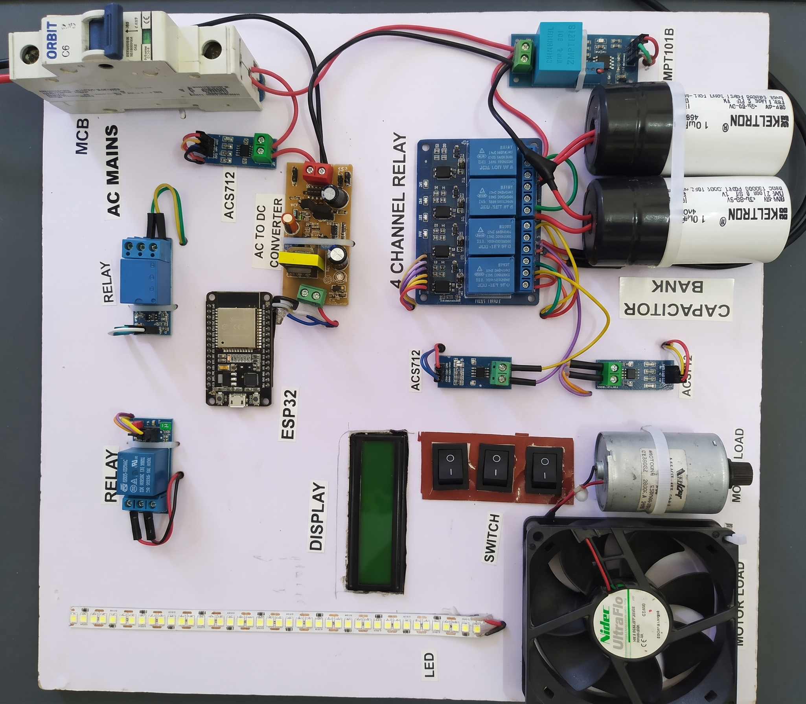

# Physical Prototype Architecture & Hardware Test Bench

**Document ID:** IMG-PROTO-APFC-2026-REV2  
**Target Platform:** ESP32 DevKit V1 Hardware Prototype  
**Classification:** Physical Layout, Subsystem Callout & Benchtop Electrical Verification  

---

## Overview

This directory archives the physical benchtop hardware implementation of the **Dual-Core Edge Computing Framework for Power Factor Correction (PFC) and Load Demand Management (LDM)**. 

The physical prototype bridges theoretical simulations and digital twin models by validating high-speed analog acquisition, deterministic FreeRTOS core isolation, optocoupler-isolated switching, and reactive power compensation under real physical electrical loads.

---

## 📷 Physical Hardware Benchtop Prototype



---

## 1. Physical Hardware Layout & Subsystem Callouts

The prototype layout enforces physical separation between high-voltage AC mains paths and sensitive low-voltage digital/analog circuits to suppress inductive switching transients and electromagnetic interference (EMI):

```
┌─────────────────────────────────────────────────────────────────────────────────────────────────────────┐
│                                       BENCH PROTOTYPE SUBSYSTEM MAP                                     │
├──────────────────────────┬──────────────────────────────────────────┬───────────────────────────────────┤
│ Subsystem / Zone         │ Key Components Visible                   │ Functional Role                   │
├──────────────────────────┼──────────────────────────────────────────┼───────────────────────────────────┤
│ 1. AC Input & Protection │ • 2-Pin AC Mains Inlet Cord              │ • Single-phase 230V AC interface  │
│                          │ • Single-Pole C-Curve MCB (6A/10A)       │ • Overcurrent & short-circuit trip│
│                          │ • 3x Manual Rocker Switches              │ • Hardware maintenance bypass     │
├──────────────────────────┼──────────────────────────────────────────┼───────────────────────────────────┤
│ 2. Switching & Isolation │ • 4-Channel 5V/12V Relay Board (PC817)   │ • Stepped capacitor bank actuation│
│                          │ • 2x Single-Channel Relays               │ • Master grid disconnect & DC rail│
│                          │ • Jumper Removed (`JD-VCC` Rail)         │ • Independent coil power isolation│
├──────────────────────────┼──────────────────────────────────────────┼───────────────────────────────────┤
│ 3. Reactive PFC Stage    │ • Dual 10 µF AC Capacitors (CBB61 type)  │ • Parallel reactive VAR injection │
│                          │ • 2x 1 MΩ 0.5W Ceramic Bleeder Resistors │ • Passive residual charge drain   │
├──────────────────────────┼──────────────────────────────────────────┼───────────────────────────────────┤
│ 4. Transduction & AFE    │ • ZMPT101B Potential Transformer Module  │ • AC mains waveform acquisition   │
│                          │ • 3x ACS712-05B Hall-Effect Sensors      │ • Ch 1 (Res), Ch 2 (Ind), Ch 3 (Tot)│
│                          │ • 1.8 kΩ / 3.3 kΩ Voltage Dividers       │ • ADC 3.23V maximum overvoltage clamp│
├──────────────────────────┼──────────────────────────────────────────┼───────────────────────────────────┤
│ 5. Compute & Telemetry   │ • ESP32 DevKit V1 (Xtensa LX6 @ 240 MHz) │ • Core 0 (5 kHz ISR) + Core 1 (LDM)│
│                          │ • 16×2 Character LCD with I2C Backpack   │ • Real-time V, I, P, cos(θ) local UI│
├──────────────────────────┼──────────────────────────────────────────┼───────────────────────────────────┤
│ 6. Mixed Dynamic Loads   │ • Nidec Compact DC/BLDC Motor Assembly   │ • Lagging PF inductive test load  │
│                          │ • 24V DC Brushless Exhaust Fan           │ • Inductive auxiliary airflow load│
│                          │ • 15 cm 12V DC LED Strip                 │ • Unity PF (1.00) resistive load  │
│                          │ • 230V AC to 12V DC SMPS Step-Down Module│ • DC bus generation for test loads│
├──────────────────────────┼──────────────────────────────────────────┼───────────────────────────────────┤
│ 7. Power & Grounding     │ • 2x Independent Regulated DC Adapters   │ • Isolated Logic (5V) & Coils (12V)│
│                          │ • Centralized Star Ground Screw Bus      │ • Zero ground loops & bounce free │
└──────────────────────────┴──────────────────────────────────────────┴───────────────────────────────────┘
```

---

## 2. Critical Hardware Engineering Practices Highlighted

### 2.1 Enforced Star Grounding Architecture
- **Implementation:** Visible at the centralized screw-terminal bus block.
- **Verification:** Sensor analog reference returns (ZMPT101B, 3x ACS712), microcontroller digital logic ground (`GND`), and isolated actuator returns do not share daisy-chained traces. Each return path terminates directly at the brass star bus, eliminating ground bounce when motor coils and relay armatures energize.

### 2.2 Physical Optocoupler Decoupling
- **Implementation:** The `VCC-JD-VCC` shunt jumper on the 4-channel relay board is physically removed.
- **Verification:** The relay coils draw pull-in currents ($\approx 70\text{--}80\text{ mA}$) exclusively from an isolated external secondary DC adapter. The ESP32 logic rail powers only the internal PC817 optocoupler LEDs ($<3\text{ mA}$), preventing inductive flyback spikes ($L \frac{di}{dt}$) from triggering microcontroller brownout resets (`BOR`).

### 2.3 Signal Conditioning & ADC Protection
- **Implementation:** Metal-film resistor dividers ($1.8\text{ k}\Omega \pm 1\%$ and $3.3\text{ k}\Omega \pm 1\%$) are mounted inline between the $5\text{V}$ ACS712 sensor outputs and the ESP32 analog pins.
- **Verification:** Clamps peak sensor output voltages to a safe $3.23\text{V}$, shielding the ESP32's internal ESD protection diodes and ADC1 gates from overvoltage destruction during high inductive inrush transients.

### 2.4 Capacitive Discharge Safety
- **Implementation:** $1\text{ M}\Omega,\ 0.5\text{W}$ bleeder resistors are permanently soldered directly across the terminal spades of both $10\ \mu\text{F}$ metallized polypropylene capacitors.
- **Verification:** Ensures stored peak DC voltages ($V_{peak} \approx 325\text{V}$) automatically drain to $<30\text{V}$ within $30\text{ seconds}$ post-isolation, preventing electrical shock hazards during manual handling and contact restrike during rapid switching.

---

## 3. Benchtop Test Points for Laboratory Probing

For hardware validation and waveform verification using an external digital storage oscilloscope (DSO):

| Test Point | Location | Expected Signal / Waveform | Verification Purpose |
|:---:|:---|:---|:---|
| **TP-V** | ZMPT101B `OUT` Pin | $2.0\text{ V}_{p-p}$ Sinusoid centered at $1.65\text{ V DC}$ | Voltage scaling, offset alignment & clipping margin |
| **TP-I1** | ACS712 Ch 1 Divider Node | AC voltage proportional to resistive load current | Unity power factor current baseline ($\theta \approx 0^{\circ}$) |
| **TP-I2** | ACS712 Ch 2 Divider Node | AC voltage lagging TP-V by $40^{\circ}\text{--}48^{\circ}$ | Uncompensated inductive current waveform ($\cos\theta \approx 0.70$) |
| **TP-ITOT**| ACS712 Ch 3 Divider Node | AC voltage shifting toward TP-V ($\theta \le 16^{\circ}$) | Corrected total current waveform following capacitor step |
| **TP-GATE**| Relay 1 Control Line (`GPIO 18`)| Active-LOW pulse ($3.3\text{V} \rightarrow 0\text{V}$) | Sub-cycle relay actuation trigger latency ($<10\text{ ms}$) |
| **TP-GND** | Central Star Ground Terminal | Flat $0.0\text{V DC}$ reference ($<10\text{ mV}$ noise floor) | Verification of star grounding integrity under load switching |

---

## 4. Bench Operating & Safety Protocol

1. **Pre-Power Verification:** Ensure the single-pole MCB is toggled to the **OFF** position prior to plugging the 2-pin mains cable into the AC wall outlet.
2. **Logic Rail Bring-Up:** Connect the 5V isolated DC logic adapter first. Confirm that the ESP32 power LED illuminates and the 16×2 character LCD initializes with zero-load baseline values ($V \approx 0\text{V}, I \approx 0.00\text{A}, PF = 1.00$).
3. **Actuator Rail Bring-Up:** Connect the secondary isolated DC supply to the relay coil bus (`JD-VCC`).
4. **Mains Bus Energization:** Toggle the MCB to the **ON** position to energize the 230V AC bus through the input voltage transformer and master disconnect relay.
5. **Inductive Step Injection:** Switch on the Nidec motor assembly via the manual override toggle. Observe the real-time drop in power factor to $0.68\text{--}0.74$ on the LCD, followed by automatic sub-cycle relay engagement of the $10\ \mu\text{F}$ capacitor bank, restoring power factor to $\ge 0.96$ within 1 to 2 AC cycles ($20\text{--}40\text{ ms}$).

---

## 🔗 Cross-Referenced System Documentation

- **Wiring Schematics & BOM:** [`Hardware/Connections.md`](../Hardware/Connections.md)
- **Component Specifications:** [`Hardware/Components_and_BOM.md`](../Hardware/Components_and_BOM.md)
- **Hardware Diagnostics Log:** [`Documentation/Troubleshooting.md`](../Documentation/Troubleshooting.md)
- **Engineering Specification:** [`Documentation/Project_Specification.md`](../Documentation/Project_Specification.md)
- **Demonstration Media:** [`Videos/README.md`](../Videos/README.md)